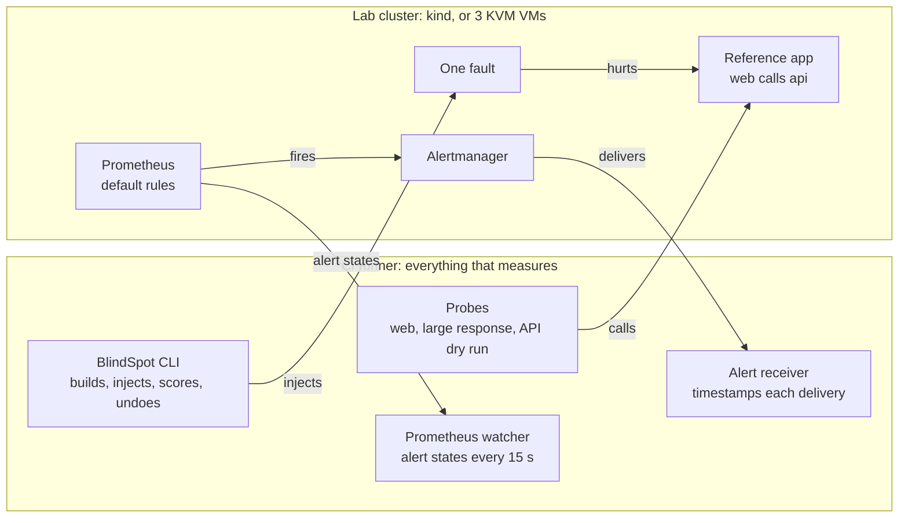

<div align="center">

# BlindSpot

### Breaks a test Kubernetes cluster in real ways, and measures which failures the monitoring actually tells someone about

[](https://github.com/aymen-nasri/blindspot/actions/workflows/ci.yml)


**[Results page](https://aymen-nasri.github.io/blindspot/)** · [Raw results](results) · [Method](docs/method-v0.2.md) · [Design decisions](docs/decisions)

</div>

Most teams install kube-prometheus-stack and trust its default alerts to tell them when something breaks.
BlindSpot tests that. Each trial builds a fresh cluster, breaks one thing, proves from outside the
cluster that users were really hurt, and records whether an alert actually reached someone.

## At a glance

| | |
|---|---|
| **What it does** | Injects one real failure at a time into a disposable Kubernetes cluster, confirms the harm with probes outside the cluster, and records whether the monitoring delivered an alert, fired one that reached nobody, only started waiting, or did nothing |
| **What it found** | kube-prometheus-stack 92.22.0 with its default rules caught **all 3 common app failures**, **3 of 3 node failures on real VMs** that hurt the app, but **1 of 10 harder infrastructure failures**, mostly after about 16 minutes. In 1 of 5 kubelet trials the alert fired and reached nobody, because Alertmanager was on the broken node |
| **Built with** | Python · Pydantic · kind · kubeadm · Helm · Prometheus · Alertmanager · blackbox-exporter · promtool · pint · QEMU/KVM · libvirt · cloud-init · Ansible · GitHub Actions · GitHub Pages · Gitleaks · Trivy · CodeQL · Cosign |
| **Evidence it works** | 160 trials with raw results in Git, 4 controls that test the tool itself on each lab (all 40 control trials passed), 151 unit tests, proposed rules checked by `promtool` and `pint` in CI, and scoring rules committed before each run |
| **Status** | Done on kind (v0.2), with common app faults and a quiet test (v0.4), and on real VMs for 3 node faults (v0.3). Results still coming in: 2 node faults rerunning after fixes, and the proposed fixes (Profile C). Nothing has run on a production cluster, and it must not |

## Table of contents

- [The result](#the-result)
- [Build status](#build-status)
- [Where to look, by role](#where-to-look-by-role)
- [How it works](#how-it-works)
- [Quick start](#quick-start)
- [Faults and controls](#faults-and-controls)
- [Proposed fixes](#proposed-fixes)
- [The VM lab](#the-vm-lab)
- [Method and fairness](#method-and-fairness)
- [CI/CD](#cicd)
- [Safety](#safety)
- [Repository layout](#repository-layout)
- [Roadmap](#roadmap)
- [AI use](#ai-use)

## The result

kube-prometheus-stack 92.22.0 with its default rules caught **all 3 common app failures**, **3 of 3
node failures on real VMs** that hurt the app, and **1 of 10 harder infrastructure failures**. Each
fault ran 5 times, each time on a fresh cluster, and checks outside the cluster confirmed the harm
before a trial was scored. All 40 control trials passed, 20 on each lab.

**Common app failures** ([results/v0.4](results/v0.4), the failures the defaults are built for):

| # | Failure | What the monitoring did, in 5 of 5 trials |
|---|---|---|
| 2 | Out of memory | **Caught.** `KubePodCrashLooping` delivered 942 to 964 s after the app went down |
| 3 | Bad image in a rollout | **Caught.** `KubePodNotReady` delivered 930 to 971 s after |
| 4 | All replicas unready | **Caught.** `KubePodNotReady` delivered 930 to 956 s after |

**Node failures on real VMs** ([results/v0.3](results/v0.3), on a three-node kubeadm cluster of KVM
virtual machines, each fault on the web app's node):

| # | Failure | What the monitoring did |
|---|---|---|
| 17 | Node disk full | **Caught** in 5 of 5. `KubeDeploymentReplicasMismatch` delivered 944 to 973 s after the app was hurt |
| 18 | Node out of inodes | **Caught** in 5 of 5. `KubeDeploymentReplicasMismatch` delivered 933 to 992 s after |
| 22 | Kubelet stopped | **Caught** in 4 of 5. `TargetDown` delivered 596 to 601 s after. In the fifth trial, Alertmanager was on the stopped node, and nothing was delivered at all ([why](docs/investigations/kubelet-placement.md)) |
| 20 | Node memory pressure | No result yet. The fault did no harm in any trial, most likely because `stress-ng` let the kernel kill its own workers. Fixed and rerunning |
| 23 | containerd stopped | No result yet. Running containers don't need containerd, so stopping it, even during a rollout, didn't hurt the app. Rerunning as "containerd stopped, then the app crashes" |

What changed after these trials, and why, is in [docs/method-v0.3.md](docs/method-v0.3.md), written
before the reruns.

**Harder infrastructure failures** ([results/v0.2](results/v0.2), on kind, chosen because their results
were hard to predict, and each gave the same outcome in all 5 of its trials):

| # | Failure | What the monitoring did, in 5 of 5 trials |
|---|---|---|
| 1 | App keeps crashing | **Caught.** `KubePodCrashLooping` delivered 942 to 956 s after the app went down |
| 5 | CPU throttled | Fired `CPUThrottlingHigh` after 918 to 943 s, but it has `info` severity, and `InfoInhibitor` muted it. Nobody was told. [What this row means](#what-the-cpu-faults-row-means) |
| 8 | Upstream DNS returns NXDOMAIN | Nothing fired |
| 9 | DNS very slow | Nothing fired |
| 10 | 40% packet loss into a backend | `KubePodNotReady` started waiting, after 7 to 583 s, and never fired within 30 minutes |
| 11 | MTU black hole | Nothing fired |
| 14 | NetworkPolicy blocks the app | Nothing fired |
| 25 | Admission webhook down | `KubeAPIErrorBudgetBurn` started waiting after 83 to 118 s, and never fired |
| 32 | Alertmanager down, then the app crashes | Alerts fired, including `PrometheusNotConnectedToAlertmanagers` after 857 to 891 s, and none could be delivered |
| 33 | Prometheus down | Nothing fired. The always-on `Watchdog` alert stopped arriving about 3 minutes later, which only an outside dead man's switch would notice |

**Why, in one breath:** the defaults catch what they were built for, like crash loops, after a
deliberate 15-minute wait. The chart ships no rules for CoreDNS, nothing measures errors between
services or large responses, `info` alerts are muted unless something more serious fires in the same
namespace, and when the monitoring itself goes down, only something outside the cluster can tell.

**False alarms:** the quiet test ran an hour of normal work five times, with rolling restarts, scaling, a
CronJob and a cordoned node, and the defaults delivered no alert at all. Two rules started their wait
and never finished it, which is the `for` duration absorbing normal blips as designed
([results](results/v0.4)). The 20-minute negative control was silent in all five trials too.

Earlier runs, with one trial each, gave the same outcomes: [results/v0.0](results/v0.0) and
[results/v0.1](results/v0.1).

**What this does and doesn't show.** Ten faults, on kind, with a small app. They weren't picked at
random: the crash was included as one the defaults should catch, and the other nine because their
results were the hardest to predict. So 1 of 10 isn't a catch rate for failures in general, and common
app failures such as a bad image or a failing readiness probe are what the default rules are built for.
It shows that default rules miss many infrastructure failures, not what any particular production
cluster misses. Many default rules wait 15 minutes before firing by design, and the scoring counts those
as caught: the crash above was caught after about 16 minutes, as designed. The chart sends alerts to a
receiver called `null` by default, so a real team would also have to configure delivery. This lab did
that.

### What the CPU fault's row means

Harm is confirmed once, near the start of each trial. For the CPU fault, it was confirmed about 40 s in,
but by the end of the window the probes no longer met the harm threshold. A rerun that recorded every
probe minute by minute ([docs/investigations/cpu-throttle.md](docs/investigations/cpu-throttle.md))
showed why: the harm that made those trials valid was the web pods restarting in the first minute, when
the new limit replaced them. After that, throttling made the app 15 to 100 times slower for the whole
window, but never past the 1.5 s threshold set before the run.

So fault 5's row reads "throttling went unreported", not "users were hurt and nobody was told".
`CPUThrottlingHigh` fired every time and was muted every time.

## Build status

| Area | ✅ Built and measured | 🧪 Built, results pending | 📐 Planned |
|---|---|---|---|
| **Faults** | 10 faults and 3 common app faults on kind, and 3 node faults on real VMs, 5 trials each | 2 node faults, rerunning after fixes | The rest of the spec's 34: clock skew, conntrack, etcd, the scheduler and more |
| **Measurement** | Outside probes, alert receiver, Prometheus watcher read through the API server, minute-by-minute harm timeline, and a quiet test for false alarms (no false alarm in 5 hours) | — | — |
| **Labs** | kind 0.33.0, and a three-node VM lab on free runners. All four controls pass on both | — | — |
| **Monitoring compared** | kube-prometheus-stack defaults | The defaults plus BlindSpot's proposed fixes (Profile C) | awesome-prometheus-alerts as another setup |
| **Fixes** | Five rules and synthetic probes, each passing `promtool`, `pint` and a unit test in CI, each with a runbook | Whether each catches its fault in 4 of 5 trials and stays quiet | Sending findings to the rules' maintainers |
| **Delivery** | CI on every push, a 70-job trial matrix, actions pinned by SHA, downloads checked by hash, a results page on GitHub Pages, Gitleaks, Trivy, CodeQL, Dependabot, a weekly regression that opens an issue on change, and a release workflow that signs with Cosign | — | A first signed release, once v0.5's results are in |

## Where to look, by role

| If you're hiring for… | Read | Then open |
|---|---|---|
| **SRE / platform engineering** | [The result](#the-result), [the CPU investigation](docs/investigations/cpu-throttle.md) | [`faults/`](faults), [`scoring.py`](src/blindspot/scoring.py), a raw trial such as [`crashloop-1.json`](results/v0.2/crashloop-1.json) |
| **Observability** | [Method](docs/method-v0.2.md), [proposed fixes](#proposed-fixes) | [`blindspot.rules.yml`](rules/blindspot.rules.yml), [its unit tests](rules/tests/blindspot.test.yml), [`runbooks/`](docs/runbooks) |
| **Kubernetes administration** | [The VM lab](#the-vm-lab), [the network faults](faults/network) | [`vmlab/ansible/`](vmlab/ansible), [`injectors.py`](src/blindspot/injectors.py) |
| **DevOps / CI/CD** | [CI/CD](#cicd), [design decisions](docs/decisions) | [`trial.yml`](.github/workflows/trial.yml), [`pages.yml`](.github/workflows/pages.yml) |
| **Security / DevSecOps** | [Safety](#safety), [CI/CD](#cicd) | [`security.yml`](.github/workflows/security.yml), [`release.yml`](.github/workflows/release.yml), [`guard.py`](src/blindspot/guard.py) |

## How it works



One trial, from `blindspot run --fault <id>`:

1. **Build** a fresh cluster, install kube-prometheus-stack at a pinned version and a two-service app.
   No trial can inherit alert state from another.
2. **Guard**: refuse unless the cluster is clearly a BlindSpot lab.
3. **Prove delivery**: wait for the always-firing `Watchdog` alert to reach the receiver. Without it,
   "missed" could mean nothing could have been delivered, so the trial is invalid.
4. **Baseline**: watch for 5 minutes and record anything already active. It never earns credit.
5. **Inject** one fault. This is T0.
6. **Confirm harm** with probes outside the cluster. A fault that hurt nobody is invalid, never missed.
7. **Watch** for the fault's window, at least 30 minutes, timing alerts as pending, firing and delivered.
8. **Score**, **undo** every step in a `finally` block, check the app recovers, and delete the cluster.

Each trial writes one JSON file with everything it saw: [an example](results/v0.2/crashloop-1.json).

## Quick start

On a Linux machine with Docker, kind, kubectl and Helm. One trial takes about 45 minutes.

```bash
python3 -m pip install .
blindspot doctor
blindspot faults list
blindspot run --fault dns-nxdomain --trials 5 --out results/mine
blindspot score results/mine
blindspot report results --out site
```

Each trial creates its own kind cluster and deletes it afterwards. Add `--keep-lab` to look around.
Node faults need the VM lab: add `--lab-type vm` on a machine with KVM, libvirt and Ansible, as in
[`trial.yml`](.github/workflows/trial.yml).

## Faults and controls

Each fault is a YAML file in [faults/](faults): what to break, how to confirm the harm, which alerts
count, and why the fault matters. Fault files only choose from injectors whose commands are fixed in
code, so adding a fault means adding a file, and a file can't run arbitrary commands.

| # | Fault | Lab | How it's made | Status |
|---|---|---|---|---|
| 1 | App keeps crashing | kind | The container's command becomes `exit 1` | Measured |
| 2 | Out of memory | kind | A memory limit of 8 MiB | Measured |
| 3 | Bad image in a rollout | kind | An image tag that doesn't exist | Measured |
| 4 | All replicas unready | kind | A readiness probe on a path that returns 404 | Measured |
| 5 | CPU throttled | kind | A CPU limit of 20 millicores | Measured |
| 8 | Upstream DNS returns NXDOMAIN | kind | CoreDNS's `template` plugin, for one name | Measured |
| 9 | DNS very slow | kind | CoreDNS's `erratic` plugin, 5 s on every lookup | Measured |
| 10 | Packet loss | kind | `tc netem` 40% loss inside the backend's pods | Measured |
| 11 | MTU black hole | kind | A route with MTU 1000 on the backend's node, and its ICMP feedback dropped | Measured |
| 14 | NetworkPolicy blocks the app | kind | A policy denying all ingress to the backend | Measured |
| 17 | Node disk full | VM | `fallocate`, then zeros until the disk is full | Measured |
| 18 | Node out of inodes | VM | Empty files until no inodes are left | Measured |
| 20 | Node memory pressure | VM | `stress-ng` holding the node's free memory, protected from the OOM killer | Rerunning after a fix |
| 22 | Kubelet stopped | VM | `systemctl stop kubelet` | Measured |
| 23 | containerd stopped, then the app crashes | VM | `systemctl stop containerd`, then the web app's processes killed through their cgroups | Rerunning after a fix |
| 25 | Admission webhook down | kind | A webhook with `failurePolicy: Fail` pointing at nothing | Measured |
| 32 | Alertmanager down, then a crash | kind | `replicas: 0` on its custom resource, then a crash loop | Measured |
| 33 | Prometheus down | kind | `replicas: 0` on its custom resource | Measured |

The quiet test, [faults/quiet](faults/quiet), runs an hour of normal work with no fault: rolling restarts,
scaling, a CronJob, a cordoned node. Every alert delivered is counted as a false alarm.

Four controls check the tool itself, on each lab. If one fails, no result from that lab can be trusted:

| Control | Must produce |
|---|---|
| A crash the defaults should catch | caught |
| No fault at all, for 20 minutes | nothing caught |
| A fault that does nothing | thrown out for causing no harm |
| No alert receiver | thrown out, never scored as missed |

## Proposed fixes

Finding a gap is half the job. Profile C is the chart's defaults plus BlindSpot's proposed fixes, run
against the same faults, judged by the same relevance lists:

| Fix | For the gap in |
|---|---|
| blackbox-exporter fetching the app from inside the cluster, and `BlindSpotAppProbeFailing` | Packet loss, the MTU black hole, the NetworkPolicy block |
| `CoreDNSHighNXDOMAINRate` and `CoreDNSSlowResponses`, because the chart has no CoreDNS rules | Both DNS faults |
| `CPUThrottlingHigh` at warning severity, which `InfoInhibitor` can't mute | CPU throttling |
| `KubeAPIAdmissionWebhookErrors` | The broken admission webhook |

The rules are in [rules/blindspot.rules.yml](rules/blindspot.rules.yml), and the lab loads that same file.
A rule only counts as a fix if it passes four gates: `promtool check rules` and `pint`, its `promtool`
unit test (both in CI on every push), catching its fault in at least 4 of 5 trials, and staying silent
in the quiet test ([method](docs/method-v0.5.md)). Each has a [runbook](docs/runbooks). The first two
gates pass; the trials are running.

No rule inside the cluster can catch Prometheus or Alertmanager itself going down. That needs a dead
man's switch outside the cluster, watching for `Watchdog` to stop.

## The VM lab

kind's nodes are containers sharing the runner's kernel and disk, so faults that need a real machine run
on [vmlab/](vmlab) instead. On a free 4-CPU GitHub runner with KVM, it builds a three-node
Kubernetes 1.37.0 cluster in about 4.5 minutes:

1. [`up.sh`](vmlab/up.sh) starts three Ubuntu 24.04 guests under libvirt, from a checksum-checked cloud
   image, each with a fixed address and cloud-init data holding a fresh SSH key.
2. [Ansible](vmlab/ansible) prepares each node, installs containerd and Kubernetes 1.37.0 from the signed
   package repo, runs `kubeadm init`, and joins the workers.
3. [`finish.sh`](vmlab/finish.sh) installs Flannel and waits for every node to be Ready.

The nodes use the kind lab's names, and the same control-plane metrics settings, so the same app and the
same monitoring run unchanged on both labs. All four controls passed on it, in 5 of 5 trials each.

## Method and fairness

Each version's rules were committed before its trials ran: [one trial](docs/method-v0.md),
[five trials into one row](docs/method-v0.2.md), [node faults](docs/method-v0.3.md) and
[common app faults](docs/method-v0.4.md). A rule found wrong after results exist is fixed in its own
commit, saying why. Why it's built this way: [docs/decisions](docs/decisions).

- **A fault only counts if it hurt.** Probes outside the cluster must see over 5% failures, or slow
  responses, within a minute.
- **Only delivery counts as caught**, because only a delivered alert tells a person.
- **Which alerts count is written in each fault's file before it runs.**
- **Alerts already active at the fault never earn credit.**
- **Five trials per fault.** A fault's outcome needs a strict majority of at least 3 valid trials, and
  times are shown in whole minutes, the precision the 30-second intervals allow.

### Changes from the chart's defaults

| Change | Why |
|---|---|
| A webhook receiver for Alertmanager | The chart sends everything to a receiver called `null`, so nothing could be timed |
| Watchdog sent to that receiver, repeated every minute | It also goes to `null` by default. Repeating it makes it a dead man's switch |
| Control-plane and kube-proxy metrics exposed | They listen on localhost by default, so Prometheus can't scrape them and would raise false alerts |
| Grafana turned off | It plays no part in alerting, and the runner is small |

## CI/CD

| Workflow | Trigger | What it does |
|---|---|---|
| [`ci.yml`](.github/workflows/ci.yml) | Every push and pull request | ruff, 151 tests, the proposed rules through `promtool` and `pint`, fault files load, the results page builds, the VM lab's playbook parses |
| [`trial.yml`](.github/workflows/trial.yml) | Manual | A matrix of fault × trial, one fresh cluster per job, on kind or the VM lab, then a scored summary |
| [`pages.yml`](.github/workflows/pages.yml) | Results change | Rebuilds the results page from `results/` and publishes it |
| [`vmlab.yml`](.github/workflows/vmlab.yml) | Manual | Builds the VM lab on its own, as a test |
| [`security.yml`](.github/workflows/security.yml) | Every push, and weekly | Gitleaks over every commit, and Trivy blocking on vulnerable packages and secrets |
| [`codeql.yml`](.github/workflows/codeql.yml) | Every push, and weekly | CodeQL for the Python tool and for the workflows |
| [`regression.yml`](.github/workflows/regression.yml) | Every Monday | Reruns the ten original faults and opens an issue if any outcome changed |
| [`release.yml`](.github/workflows/release.yml) | A version tag, or manual | Builds the package and a CycloneDX SBOM, signs each file with Cosign keyless, and verifies the signatures |
| [`killtest.yml`](.github/workflows/killtest.yml) | Manual | The original v0.0 test, kept so its results can be reproduced |

Every action is pinned to a commit SHA, workflows get read-only permissions by default, inputs reach
scripts through environment variables, and every download is checked against a pinned SHA-256.
Dependabot proposes updates to the pinned actions and packages every week. Trials
can only be started by people with write access, so they never run from forks.

## Safety

BlindSpot breaks things on purpose. Before any fault, it refuses any cluster whose context doesn't start
with `kind-` or `blindspot-`, that lacks a marker holding the cluster's own ID, or that has more nodes
than a lab should. On the VM lab, node commands go only to its own three nodes. These checks stop mistakes, not
someone determined to get around them, so **never point it at a cluster that matters.**

## Repository layout

```text
src/blindspot/      the tool: CLI, fault catalogue, injectors, labs, measurement, scoring, results page
faults/             one YAML file per fault, control and the quiet test, by area
rules/              Profile C's proposed rules, and their promtool unit tests
lab/                the kind cluster, the monitoring values, and the reference app
vmlab/              the VM lab: up.sh, Ansible roles, finish.sh
results/            raw results, one JSON file per trial, by version
docs/               method for each version, design decisions, runbooks, investigations
tests/              151 tests that need no cluster
harness/            the throwaway v0.0 harness, kept so its results can be reproduced
.github/workflows/  CI, trials, the VM lab and the results page
```

## Roadmap

- **v0.0, done:** the go/no-go test. Its harness is kept in [harness/](harness).
- **v0.1, done:** the tool in [src/blindspot](src/blindspot), with faults and scoring as files, a safety
  guard, undo and controls.
- **v0.2, done:** 5 trials per fault on GitHub Actions, results in Git, and the
  [results page](https://aymen-nasri.github.io/blindspot/).
- **v0.3, done in part:** the VM lab works on free runners, and its controls pass. Disk full, inodes and
  the kubelet stopping were caught; memory pressure and containerd did no harm, so they were fixed and
  are rerunning ([method and changes](docs/method-v0.3.md)).
- **v0.4, done in part:** three common app failures, all caught in 5 of 5 trials, and the quiet test,
  with no false alarm in five hours of normal work ([method](docs/method-v0.4.md)). Not done: a second
  monitoring setup, and the rest of the spec's 34 faults.
- **v0.5, in progress:** five proposed rules and synthetic probes, passing `promtool`, `pint` and their
  unit tests in CI, with runbooks. Their trials are running ([method](docs/method-v0.5.md)).
- **v1.0:** the signing release workflow is built; still to do: a first signed release, a demo, and
  instructions someone else can follow to run one fault.

## AI use

Built with the help of an AI coding assistant.

## License

[Apache-2.0](LICENSE)
